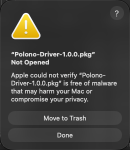
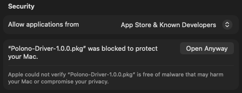
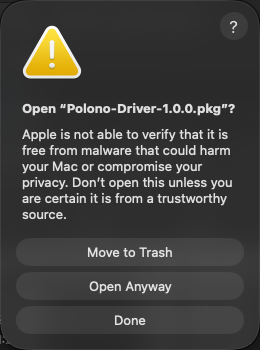
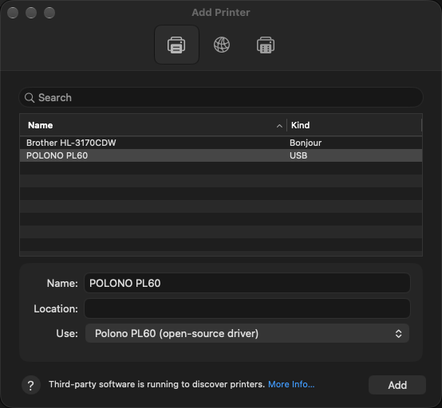

# Polono label printer driver for Mac: PL60, PL70e-BT, PL420 (open-source)

A free driver that gets **Polono PL60, PL70e-BT and PL420** thermal label printers
printing on current Macs, including Apple Silicon Macs, without Rosetta and
without Polono's own drivers.

> **An independent project.** This free, open-source driver isn't made, endorsed
> or supported by Polono.

## Supported printers

| Printer | Status |
|---|---|
| Polono PL60 | Matches Polono's driver output. Tested on a real printer |
| Polono PL70e-BT (over USB) | Matches Polono's driver output. Not yet tried on a real printer |
| Polono PL420 | Matches Polono's driver output. Not yet tried on a real printer |

"Matches Polono's driver output" means that for the same print job, this driver
sends the printer exactly the same bytes as Polono's own Mac driver. This was
checked for every option the driver offers ([how](docs/TSPL.md#how-it-was-checked)).
If you have a PL70e-BT or PL420, a test print and a quick
[report](https://github.com/brossow/polono-macos-driver/issues) would be a big help.

Other Polono models aren't supported yet. The PL80E and PM220S were looked at
and deliberately left out: Polono's own drivers for them change labels in ways
that look like bugs (for example, removing some blank space, or moving content
up the label), so "the same bytes as Polono's driver" isn't a useful promise for
them. The details are in [docs/TSPL.md](docs/TSPL.md#not-supported-pl80e-and-pm220s).
For those and other models (A400 and so on), see
[Problems or questions](#problems-or-questions).

## Is this for me?

It probably is if any of these sound familiar:

- Your Polono printer used to print, and since you got a new Mac or updated macOS it doesn't.
- Printing fails, or the print queue says **"Filter failed"**.
- You found advice to "install Rosetta" and would rather not, or you're worried
  about what happens when Apple removes Rosetta (from macOS 28 on).

### Symptoms

What people with this problem typically see:

- A Polono PL60, PL70e-BT or PL420 is **not printing on a Mac** after a macOS
  update, or on a new Mac.
- The print queue shows **"Filter failed"**, **"Stopped - 'Filter' failed"** or
  **"Printer stopped"**, and the label never comes out.
- The printer shows up in **Printers & Scanners** and Polono's driver installed
  without errors, but nothing prints from Preview, Safari, Chrome or a shipping
  site (USPS, UPS, Pirate Ship, Etsy, eBay, Poshmark, Shopify).
- It happens on **Apple Silicon** Macs (M1 or later) running **macOS Big Sur (11),
  Monterey (12), Ventura (13), Sonoma (14), Sequoia (15), Tahoe (26) or Golden Gate
  (27)**, and it started after a **macOS update** or a move to a new Mac.
- It works again after installing **Rosetta 2**
  (`softwareupdate --install-rosetta`), which is the clue that the driver is
  Intel-only. This driver fixes it without Rosetta.

### Why the printer stopped working

Polono's Mac drivers for these printers were built only for older Intel Macs. On
an Apple Silicon Mac they run only through **Rosetta**, Apple's Intel translator.
Rosetta isn't installed on new Macs, and macOS doesn't tell you it's missing. The
print job just fails. Apple has also announced that from macOS 28, Rosetta will no
longer run software like printer drivers. This driver is built for both Apple
Silicon and Intel, so it doesn't depend on Rosetta at all.

## Install

1. Download **Polono-Driver-(version).pkg** from the
   [Releases page](https://github.com/brossow/polono-macos-driver/releases/latest).
2. Double-click it. macOS will say it was **Not Opened** because Apple "could not
   verify" it's free of malware. That's expected for any installer whose author
   hasn't paid Apple to sign it, see [Why the warning?](#why-the-warning) below.
   Click **Done**, not Move to Trash.

   

3. Open **System Settings → Privacy & Security** and scroll down to the
   **Security** section. You'll see that the Polono-Driver package was blocked to protect
   your Mac. Click **Open Anyway** and enter your Mac password. If the line isn't
   there, double-click the package once more, then check again.

   

4. macOS asks one last time whether to open it. Click **Open Anyway**.

   

5. The installer opens. Click **Continue** through the steps and enter your Mac
   password when asked.

**If your printer was already set up,** that's it. The installer switches it to this
driver, keeping its name and settings. Print a label to check.

**If you're setting up the printer for the first time,** plug it in and turn it on. Open
**System Settings → Printers & Scanners → Add Printer**, choose the printer, and check
that **Use** shows its open-source driver, for example **Polono PL60 (open-source
driver)**. If it doesn't, choose **Select Software** and pick it from the list. The
PL70e-BT and PL420 may need this step, because the names they report over USB
haven't been seen yet.

## Why the warning?

Apple charges developers $99 a year to sign installers so that macOS opens them
without a warning. This driver is free, and its author doesn't pay that fee, so macOS
asks you to confirm instead. Open Anyway is Apple's own built-in way to do that, for
one file at a time.

If you'd rather check what you're installing, everything is in this repository:
the driver's source code (`src/`), the printer description (`ppd/`) and the
installer scripts (`pkg/`). The installer puts exactly four files on your Mac:

- `/usr/libexec/cups/filter/rastertotspl`: the driver itself
- `PL60-open-source.ppd`, `PL70e-open-source.ppd` and `PL420-open-source.ppd` in
  `/Library/Printers/PPDs/Contents/Resources/`: the printer options macOS shows
  you, one file per printer

It also keeps a copy of your printer's old settings in
`/Library/Application Support/Polono Open-Source Driver/` so they can be restored if
you uninstall.

## Printer options

These are in the print dialog. Look under the app's pop-up menu for **Printer
Features**, or set your defaults in System Settings → Printers & Scanners →
Options & Supplies. Each printer gets the options Polono's own driver offers for
it, under the same names, so a printer switched over from Polono's driver keeps
its settings.

| Option | PL60 | PL70e-BT | PL420 |
|---|---|---|---|
| Label Size | 100 × 150 mm by default, which suits most "4 × 6" rolls. Choose **4 × 6 in** only if your labels really are 4 inches wide, or the right edge gets cut off. Plus common inch and metric sizes, and custom sizes up to 4.25 in wide | Polono's list for the printer, 100 × 150 mm by default, and custom sizes up to 4.08 in wide | Polono's list for the printer, 100 × 150 mm by default, and custom sizes up to 4.08 in wide |
| Darkness | 0 to 15, or the printer's own setting (the default) | 0 to 15 (8 by default), or the printer's setting | 0 to 15 (8 by default), or the printer's setting |
| Print Speed | 2 to 6 in/s, or the printer's setting | 1 to 8 in/s, or the printer's setting | 1 to 8 in/s (8 by default), or the printer's setting |
| Media Type | Gaps, black marks or continuous | Gaps, black marks or continuous | Gaps or continuous |
| Greys | Sharp (50% grey or darker prints) or dithered | Black and white with an adjustable threshold (31% grey by default), Brightness, and ten dithering patterns | Anything 22% grey or darker prints |
| Turning the label | Rotation, Mirror Image, Negative Image | Rotation | Print Direction (Polono's default is "Normal") |
| Position | Vertical Start Position, Stop Position Offset | Horizontal and Vertical Offset (8 mm per step, as Polono's driver does), Stop Position Offset | Horizontal and Vertical Offset (1 mm per step), Stop Position Offset |
| After printing | Stop at the tear-off position, or do nothing | — | — |
| Dotted line between labels | — | Yes / No | Yes / No |

A few options in Polono's own drivers are left out because they don't do what
they say: the PL420's "Black Line" media type sends the same gap-sensing setting
as "Gap", and the PL70e-BT's Contrast and Crop Edge options change nothing.
"Print Method" is left out on both because it changes nothing.

## Uninstall

Download **Uninstall-Polono-Driver-(version).pkg** from the
[Releases page](https://github.com/brossow/polono-macos-driver/releases/latest) and
open it the same way as the installer. Your printer goes back to the driver it had
before. Keep in mind that Polono's drivers only work on Apple Silicon while Rosetta is
installed.

## Problems or questions

[Open an issue](https://github.com/brossow/polono-macos-driver/issues). Please include
your Mac model, your macOS version, and what happens when you print.

**Testing and other models:** if you have a PL70e-BT or PL420, a report on how
it prints helps confirm the driver on a real printer. If you have a different
Polono model, please fill in the
[model support form](https://github.com/brossow/polono-macos-driver/issues/new?template=other-polono-model.yml).
Many Polono printers speak the same language, so one owner's help is usually all
it takes to add a model.

## Support the project

The driver is free. If it saved your printer and you'd like to say thanks, you
can [leave a tip on PayPal](https://paypal.me/brossow).

## For developers

How the driver works and how it was checked: [docs/TSPL.md](docs/TSPL.md).
Building, testing and making the installer: [docs/DEVELOPING.md](docs/DEVELOPING.md).

MIT licence, see [LICENSE](LICENSE). Polono is a trademark of its owner.
